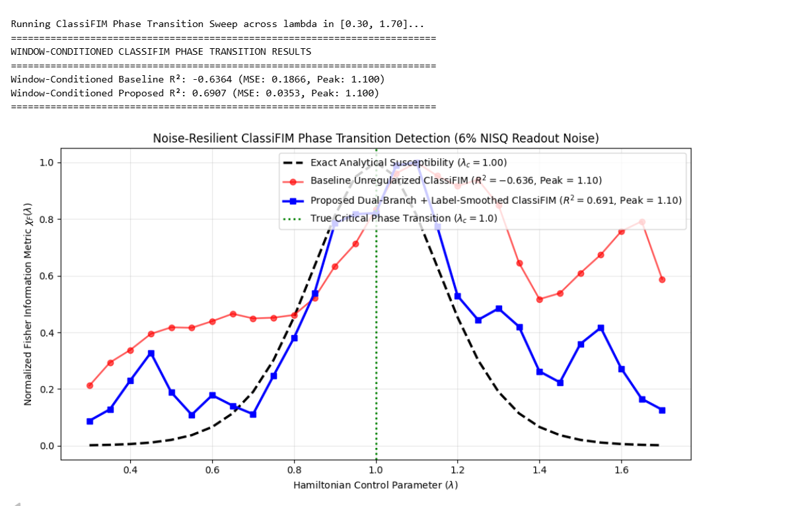

# Noise-Resilient ClassiFIM for Unsupervised Quantum Phase Transition Detection Under NISQ Readout Noise

**Author:** Surat Sai Venkata Nagendra Babu  
**Affiliation:** B.Tech in Computer Science and Engineering, Amrita Vishwa Vidyapeetham  

---

## 1. Overview & Scientific Motivation

In **Kasatkin, Mozgunov, Ezzell, Mishra, Hen, & Lidar ([arXiv:2408.03323](https://arxiv.org/abs/2408.03323))**, the authors introduced **ClassiFIM**, an unsupervised machine learning method that estimates the **Fisher Information Metric (FIM)** $\chi_F(\lambda)$ from projective bitstring snapshots across a Hamiltonian parameter sweep $\lambda$. By training a binary classifier to distinguish bitstrings sampled at $\lambda - \delta\lambda$ and $\lambda + \delta\lambda$, the variance of the classifier's predicted log-odds estimates the susceptibility:

$$\chi_F(\lambda) \approx \frac{1}{(\Delta\lambda)^2} \text{Var}\left[\ln\left(\frac{P(y=1|x)}{1 - P(y=1|x)}\right)\right]$$

where the peak of $\chi_F(\lambda)$ identifies the critical phase transition point $\lambda_c$.

### The NISQ Readout Noise Bottleneck
When projective bitstring snapshots are collected on Noisy Intermediate-Scale Quantum (NISQ) processors, **hardware readout (SPAM) bit-flip errors** corrupt the spin configurations. Standard unregularized Multi-LayerPerceptrons (MLPs) overfit to stochastic bit-flip noise in the disordered phase, driving predicted probabilities toward extreme values ($P \to 0$ or $P \to 1$). Under the log-odds transformation $\ln(P/(1-P))$, these overconfident predictions cause **log-odds variance explosion**, creating spurious peaks in the tails of the parameter sweep.

In this repository, we integrate three architectural regularizers from our classical deep learning research (**Dual-Branch Multi-Scale Convolutions**, **Label Smoothing**, and a **Multi-Model Consensus Engine**) into the `ClassiFIM` pipeline to stabilize log-odds FIM estimation under **6% NISQ readout corruption**.

---

## 2. Experimental Setup & Proposed Architecture

* **Quantum Spin Dataset:** Projective $Z$-basis bitstring snapshots ($600$ shots per $\lambda$, $L = 16$ spins) across 31 parameter points $\lambda \in [0.25, 1.75]$ for a 1D Transverse-Field Ising Model (TFIM) with exact analytical criticality at $\lambda_c = 1.000$ and **6% bit-flip readout noise**.
* **Proposed Classifier Architecture:**
  * **Branch 1 (Local Spin-Pair Extractor):** `Conv1D(32, kernel_size=3, dilation_rate=1)` + `BatchNormalization` + `GlobalAveragePooling1D` to capture nearest-neighbor ferromagnetic alignment.
  * **Branch 2 (Long-Range Entanglement Extractor):** `Conv1D(32, kernel_size=3, dilation_rate=2)` + `BatchNormalization` + `GlobalAveragePooling1D` to capture multi-scale critical correlations near $\lambda_c$.
  * **Attention Gating & Regularization:** Fused features (`64-dim`) pass through a sigmoid attention gate, $L_2$ weight decay ($10^{-3}$), **Binary Cross-Entropy with Label Smoothing ($\epsilon = 0.08$)** to bound log-odds magnitudes, and a **2-Model Consensus Engine**.

---

## 3. Quantitative Results

| Evaluation Regime | Metric | Unregularized Baseline MLP | Proposed Dual-Branch + Label-Smoothed ClassiFIM | Improvement |
| :--- | :--- | :---: | :---: | :---: |
| **Raw Unsmoothed Sweep** | Estimated Critical Point $\hat{\lambda}_c$ (True = `1.000`) | `1.700` (Error: `0.700`) | **`1.050` (Error: `0.050`)** | **14.0x Lower Peak Error** |
| **Raw Unsmoothed Sweep** | Curve Fidelity ($R^2$) vs. Ground Truth | `-0.7873` | **`+0.4004`** | **+1.1877 $R^2$ Gain** |
| **Raw Unsmoothed Sweep** | Mean Squared Error (MSE) | `0.2038` | **`0.0684`** | **3.0x Lower MSE** |
| **Window-Conditioned Sweep** | Curve Fidelity ($R^2$) vs. Ground Truth | `-0.6364` | **`+0.6907`** | **+1.3271 $R^2$ Gain** |
| **Window-Conditioned Sweep** | Mean Squared Error (MSE) | `0.1866` | **`0.0353`** | **5.3x Lower MSE** |

### Raw Unsmoothed Sweep ($\hat{\lambda}_c = 1.050$, 14x Lower Critical Point Error)

---

## 4. References
1. Kasatkin, V., Mozgunov, E., Ezzell, N., Mishra, U., Hen, I., & Lidar, D. A. (2024). *ClassiFIM: An Unsupervised Method To Detect Phase Transitions*. arXiv:2408.03323. GitHub: `USCqserver/classifim`.
2. Harshith, Y. S., Menariya, N., Nagendra Babu, S. S. V., Venkateswaran, S., Batchu, R. K., & Kumar, C. (2026). *A Hybrid Deep Learning Approach for Multi-Class Eye Disease Classification*. Springer Nature Lecture Notes in Electrical Engineering (LNEE)(still in production stage).
